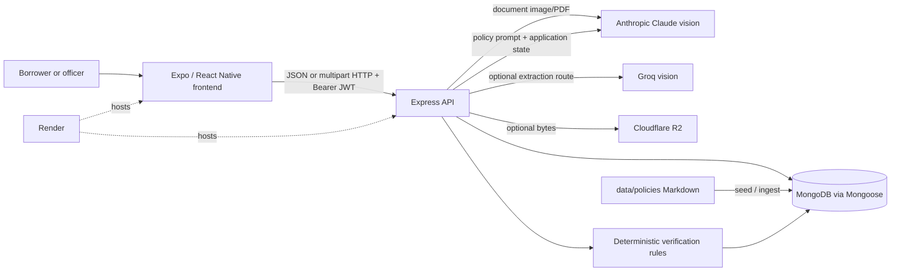
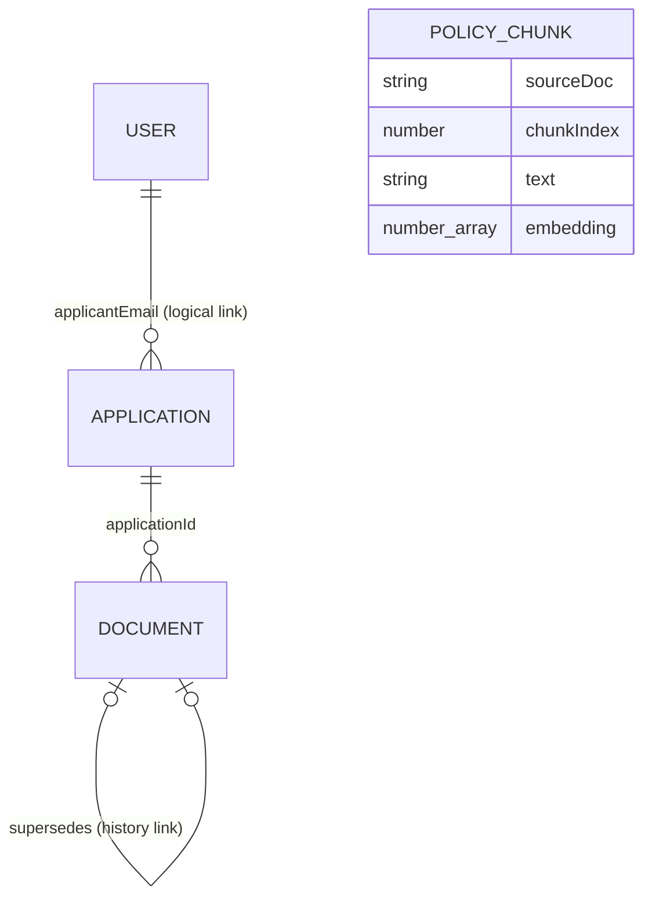
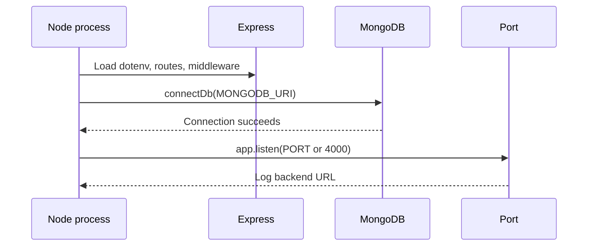
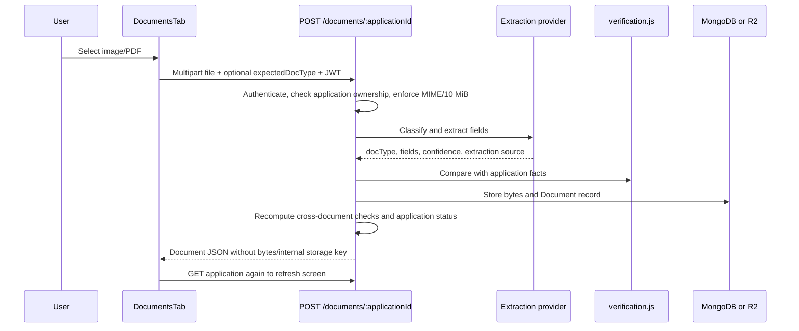

# LoanLens AI — Complete Project Guide

This guide describes the code currently in this repository. **Verified** statements come from source/configuration. **Recommendation** statements are suggestions, not existing behavior. Credentials and live customer data are intentionally not included.

## 1. Project Overview for Beginners

LoanLens AI is a demonstration application for reviewing loan applications and their supporting documents. A borrower can create an application and upload documents; a loan officer can inspect applications, see document fields and rule based checks, and ask questions about policy and a specific application.

The problem it demonstrates is the manual work of comparing information across a loan application, pay stubs, bank statements, and policy documents. The application automates document reading and repeatable comparisons, then presents explanations for a person to review. Its rules explicitly describe affordability figures as estimates, and the code does not issue an approval or denial decision.

**Example:** Jordan Rivera's seed application says monthly income is $5,000. The sample pay stub fixture says $4,200. The vision model (or the fixture in mock mode) extracts the number; `verification.js` compares the values using a 5% tolerance and displays a mismatch with an explanation.

| Concept | Simple meaning | In this project |
|---|---|---|
| Frontend | The screens the person uses | Expo app in `frontend/` |
| Backend/API | The server that accepts requests and applies rules | Express app in `backend/src/` |
| Database | Persistent organized storage | MongoDB, accessed with Mongoose |
| Model/LLM | A service that generates or interprets content | Claude or Groq vision for extraction; Claude for policy answers |
| JWT | A signed pass carried with requests to prove a session | 12-hour bearer token |
| RAG | Answering with supplied reference material | Here, all policy chunks and current application state are placed in the prompt; there is no active vector search |

## 2. What the Project Does

There are two user roles: `borrower` and `officer`. After login, the user sees applications permitted by their role. Borrowers see only applications filed under their account; officers can see all applications. Application details have Documents, Verification, and Assistant tabs.

Borrowers can register, submit one of three loan product types, provide application details and consent, and upload or re-upload supporting files. Officers can inspect all files and findings. Both roles can use the application assistant, but its system instructions vary by role. The frontend has responsive web layouts and is built with React Native Web through Expo.

The application relies on a MongoDB database and, when real model calls are enabled, an Anthropic or Groq API. Optional Cloudflare R2 storage can hold uploaded file bytes; MongoDB storage is the default and fallback. The Render configuration describes a hosted backend and static frontend.

## 3. Important Concepts Explained Simply

- **Request/response:** the app sends an HTTP request (for example, “show my applications”); the server replies with JSON data. `frontend/src/api/client.js` is the shared request wrapper.
- **Endpoint/route:** a named server URL and method. For example `POST /auth/login` checks a password and returns a token.
- **Schema/model:** rules describing the shape of saved database records. Mongoose schemas in `backend/src/models/` define four collections.
- **Middleware:** code that runs before a route. `requireAuth` checks a bearer token before protected application, document, and chat routes run.
- **Extraction:** turning document pixels or PDF pages into structured fields such as a name or income. This is an AI task here.
- **Verification:** comparing extracted fields to application facts with fixed code rules. This is not an AI task.
- **Embedding/vector search:** a way to represent text as numbers and find semantically similar text. The schema has an optional embedding field, but no embedding generation or vector query runs in the current code.
- **Fallback/mock:** deterministic fixture behavior used when `MOCK_AI=true`, or as a fallback after extraction provider errors. It supports demos and wiring checks; it does not read the uploaded contents.

## 4. Complete Technology Stack

| Area | Verified technology/version | Purpose and location |
|---|---|---|
| Language | JavaScript (ES modules on backend; JSX on frontend) | Backend source in `backend/src`; UI in `frontend/` |
| Runtime | Node.js `>=22.13.0 <25` declared for backend | `backend/package.json`; the runtime available during this investigation was Node 24.19.0 |
| API framework | Express `^4.19.2` | HTTP server, `backend/src/index.js` and routes |
| UI framework | React `19.0.0`, React Native `0.79.2` | Shared native-style UI components |
| App tooling | Expo `~53.0.0`, Metro web bundler | `frontend/app.json`, `frontend/package.json` |
| Navigation | React Navigation `^7.1.6`, native stack `^7.3.10` | Screen stack and detail tabs |
| Web UI | React Native Web `^0.20.0` | Runs React Native components in a browser |
| Database driver/ODM | Mongoose `^8.5.0` | MongoDB schemas and queries |
| Password hashing | bcryptjs `^2.4.3` | Hash/check passwords in `routes/auth.js` |
| Session tokens | jsonwebtoken `^9.0.2` | Signed 12-hour JWTs |
| Uploads | Multer `^1.4.5-lts.1` | Temporary multipart file handling; 10 MiB limit |
| AI clients | `@anthropic-ai/sdk` (`latest` in package manifest), `groq-sdk` `^1.6.0` | Claude and Groq requests |
| Optional file storage | AWS S3 client `^3.1146.0` | S3-compatible Cloudflare R2 access |
| PDF conversion | `pdf-to-png-converter` `^4.2.1` | Converts first PDF page to PNG for Groq vision |
| Environment loading | dotenv `^16.4.5` | Reads backend `.env` at startup |
| Deployment | Render Blueprint YAML | `render.yaml` |

There is no TypeScript, CSS framework, dedicated state-management library, job queue, cache, or WebSocket/streaming implementation in the inspected application code.

## 5. Repository and Folder Structure

```text
backend/                 Express API and scripts
  src/config/            Database, document requirements, affordability values
  src/middleware/        JWT authentication middleware
  src/models/            Mongoose schemas: User, Application, Document, PolicyChunk
  src/routes/            Auth, application, document, chat, admin endpoints
  src/services/          AI clients, extraction, verification, RAG, file storage
  src/scripts/           Local seed and policy-ingestion commands
  uploads/               Multer temporary upload directory
  .env.example           Backend settings template (contains placeholders)
frontend/                Expo React Native app (web enabled)
  src/api/               HTTP client
  src/components/        Shared header, sidebar, UI elements
  src/context/            Login/session state
  src/screens/            Login, registration, application, detail screens
  src/screens/tabs/       Documents, Verification, Assistant tabs
  assets/                 App icon and browser favicon
data/policies/            Synthetic/demo policy corpus in Markdown
data/seed/                Synthetic documents and assistant QA prompts
docs/                     Demo script, roadmap, planning spreadsheets
PPT content/              Architecture visuals
render.yaml               Render backend and static-site configuration
README.md                 Existing quick-start and product summary
```

Package lock files pin dependency resolution for installs. `backend/uploads/` is temporary processing space, not the durable file store.

## 6. System Architecture



In the default mode, uploaded bytes are stored in MongoDB. R2 is optional and selected by `STORAGE_PROVIDER=r2`. The assistant currently fetches all policy chunks from MongoDB and includes them in one Claude prompt, together with a summary of current application state.

## 7. Frontend Technologies and Workflow

`frontend/App.js` wraps the screen tree in `AuthProvider` and React Navigation. If there is no logged-in user, routes are Login and SignUp. Once authenticated, routes expose Applications, ApplicationDetail, and NewApplication. A sidebar appears for logged-in sessions at viewport widths of at least 900 pixels. Application detail offers Documents, Verification, and Assistant tabs.

| File | Role |
|---|---|
| `frontend/src/screens/LoginScreen.js` | Login form and demo-account affordance |
| `frontend/src/screens/SignUpScreen.js` | Create borrower/officer test accounts |
| `frontend/src/screens/ApplicationsScreen.js` | List and open permitted applications; borrower can start an application |
| `frontend/src/screens/NewApplicationScreen.js` | Multi-step product/application/disclosure form |
| `frontend/src/screens/ApplicationDetailScreen.js` | Fetches application and hosts its three tabs |
| `frontend/src/screens/tabs/DocumentsTab.js` | Upload, targeted re-upload, preview, delete, and document history |
| `frontend/src/screens/tabs/VerificationTab.js` | Displays checks and missing requirements |
| `frontend/src/screens/tabs/AssistantTab.js` | Sends questions and displays answer/source chips |
| `frontend/src/context/AuthContext.js` | Login/register/logout state and AsyncStorage session restore |
| `frontend/src/api/client.js` | API URL, bearer token, JSON/multipart requests and file fetch |
| `frontend/src/components/` | Brand header, sidebar, shared visual components |
| `frontend/src/theme.js` | Shared colors/labels/styles |

The app uses React Context for its small global authentication state and local React state for screen data. AsyncStorage persists `{token,user}` under `loanlens.session`. It does not implement server-driven chat streaming or persistent conversation history; chat messages live in the tab's local component state.

`EXPO_PUBLIC_API_URL` is read at build/start time. If missing, API calls target `http://localhost:4000`. The frontend sends JSON for ordinary calls, multipart `FormData` for uploads, and attaches `Authorization: Bearer <token>` when signed in. A 401 triggers logout through a callback registered by `AuthContext`.

## 8. Backend Technologies and Workflow

`backend/src/index.js` loads environment variables, configures Express JSON parsing and open CORS, registers `/health` plus route groups, connects to MongoDB, and only then begins listening. `PORT` defaults to 4000. A database connection failure prevents the server from starting. Async route errors are passed to a final handler that logs the error and returns a JSON error message/status.

Typical protected request path:

1. Frontend calls the API wrapper with URL and bearer token.
2. Express matches the method/path and, for protected routes, `requireAuth` verifies the JWT using `JWT_SECRET`.
3. Route applies role/ownership and request checks.
4. Route reads/writes Mongoose models and calls relevant service code.
5. Route sends JSON or file bytes; frontend updates its screen or reports the error.

There is no dependency-injection container, repository abstraction, background worker, or scheduled job. Route modules call Mongoose models and service functions directly.

## 9. Database and Data Model

MongoDB is the database; Mongoose creates/queries collections based on these model files. ObjectIds are record identifiers. Mongoose timestamps add `createdAt` and `updatedAt` where configured. No migration framework or SQL tables/foreign-key constraints were found.



| Model | Important fields | Use |
|---|---|---|
| `User` (`models/User.js`) | unique lowercase email, passwordHash, name, role | Login and role-based access; password is stored as a bcrypt hash |
| `Application` (`models/Application.js`) | applicant facts, product, amount, term, requiredDocTypes, status, consent time | Borrower intake and officer review; statuses: draft, submitted, needs-review, approved, rejected |
| `Document` (`models/Document.js`) | applicationId, type, file bytes or storage key, extractedFields, confidence, source, verification, current/superseded state | Uploaded file metadata, extracted values, checks, and audit history |
| `PolicyChunk` (`models/PolicyChunk.js`) | sourceDoc, chunkIndex, text, optional embedding | Stores policy Markdown sections for assistant context; embeddings are not generated/queried currently |

`Document.applicationId` is a Mongoose reference to Application; ownership is also checked against the application's `applicantEmail`. Superseded documents are retained on targeted re-upload and excluded from current requirements/checks. The separately exposed file endpoint avoids returning binary file content in application JSON. File bytes go into MongoDB by default, or R2 when enabled and configured. R2 upload failures fall back to MongoDB.

## 10. Complete Feature Inventory

| Feature | User action and implementation | Data/services involved | AI/external service |
|---|---|---|---|
| Login | Submit email/password in Login screen → `POST /auth/login` | User lookup, bcrypt compare, JWT | None |
| Self-registration | Submit name/email/password/role → `POST /auth/register` | User created with password hash | None; no email verification |
| Application list/detail | Open list/detail → `GET /applications`, `GET /applications/:id` | Officer sees all; borrower sees own; current docs, missing items, cross-doc checks | None |
| New application | Borrower completes multi-step form → `POST /applications` | Validates product, age, consent, product-specific fields and affordability; stores required document types | None |
| Document upload | Pick PNG/JPEG/WEBP/PDF → `POST /documents/:applicationId` | Multer accepts up to 10 MiB; extract; verify; store bytes; set review status | Claude or configured Groq; optional R2 |
| Targeted fix/re-upload | Use action-needed item; multipart `expectedDocType` sent | Validates detected type, supersedes previous slot, retains history | Extraction model unless mock/fallback |
| File preview | Fetch authenticated `GET /documents/:documentId/file`; open returned blob | Authorized read from MongoDB/R2 | Optional R2 |
| Delete document | Confirm and `DELETE /documents/:documentId` | Deletes document and best-effort R2 object; requirement becomes missing | Optional R2 |
| Verification | View comparisons in Verification tab | Fixed checks in `services/verification.js`, recomputed cross-document findings | No LLM |
| Assistant | Ask question → `POST /chat/:applicationId` | Policy chunks + current application summary; source chips returned | Claude unless `MOCK_AI=true` |
| Demo administration | Secret-guarded `/admin/*` endpoints | Seed/reset users/apps, ingest policy, status counts, test storage | Mock fixtures used to prepopulate demo docs |

The seed scenarios include a clean Priya Nair application, Jordan Rivera's income mismatch, Dana Whitfield's business revenue/name/affordability flags, and Arjun Mehta's employer warning. See `data/seed/documents/` and `backend/src/services/mockFixtures.js`.

## 11. End-to-End Application Workflows

### Application startup



### Login and protected request

1. User enters credentials on `LoginScreen.js`.
2. `AuthContext.login()` calls `api.login()`.
3. `POST /auth/login` finds the normalized email and compares password to bcrypt hash.
4. `issueSession()` signs a JWT containing user ID, role, name, and email for 12 hours.
5. Frontend saves token and user in AsyncStorage, and the shared client adds the bearer header on later requests.
6. `requireAuth` verifies the token. Routes use `req.user.role` and email to limit what the user can access.

### Loan application submission

`NewApplicationScreen.js` gathers product, requested amount, borrower/product facts, date of birth, and consent. `POST /applications` only accepts borrower role. It checks valid product, positive amount, age 18+, consent, required product data, and an allowed repayment term for consumer products. Affordability caps are advisory arithmetic based on configured ratios and terms. It saves an Application with the centralized required document list. Invalid input returns a 400 message; non-borrower returns 403.

### Document processing and re-upload



The model receives file data as base64 plus a detailed strict-JSON extraction prompt. For targeted repairs, a wrong recognized document type adds an explicit mismatch finding. Previous current documents in the target slot are marked superseded, not erased. Model/provider errors during extraction are logged and produce fixture data tagged `fallback`; this means the upload can complete without the fields actually having been read. `MOCK_AI=true` intentionally uses fixtures directly.

### Verification behavior

Checks are deterministic, with explanations: name/business name/SSN match; monthly income or annual business revenue within 5%; employer mismatch as a warning; affordability estimate; ownership range; payroll tax arithmetic (6.2% Social Security and 1.45% Medicare with 2% tolerance); YTD gross consistency with 15% tolerance; and pay-stub net pay compared to the latest bank deposit with 10% tolerance plus deposit-source/employer comparison. Missing required documents are derived from current document types. A mismatch makes a document `fail`; warnings or confidence below 0.7 make it `needs-review`; otherwise it passes. Cross-document checks are computed at read time and merged for display/status rather than persisted as independent records.

### Assistant question

`POST /chat/:applicationId` checks login, question presence, application existence, and borrower ownership. `rag.js` loads document metadata and current checks, fetches all `PolicyChunk` records in stable order, and builds a system prompt containing policy text, role guidance, and current application state. Claude is asked for strict JSON `{answer,sources}` with policy titles or `Application state` as sources. Malformed JSON falls back to returning raw model text with no sources. In mock mode it returns a deterministic open-items summary, not a generated answer and not retrieved policy content.

## 12. API Documentation

All paths are relative to the backend host. Protected endpoints require `Authorization: Bearer <JWT>` unless noted.

| Method | Path | Auth | Purpose |
|---|---|---|---|
| GET | `/health` | No | Basic service health response |
| POST | `/auth/login` | No | Login and receive a 12-hour token/user object |
| POST | `/auth/register` | No | Create officer or borrower test account |
| GET | `/applications` | Yes | List all for officer or own applications for borrower; includes missing-document count |
| POST | `/applications` | Yes, borrower | Validate and create application |
| GET | `/applications/:id` | Yes | Application plus metadata-only documents, missing items, and open exceptions |
| POST | `/documents/:applicationId` | Yes, owner/officer | Multipart file upload; optional `expectedDocType` |
| GET | `/documents/:documentId/file` | Yes, owner/officer | Stream stored bytes inline for preview/download |
| DELETE | `/documents/:documentId` | Yes, owner/officer | Delete document and best-effort external object |
| POST | `/chat/:applicationId` | Yes, owner/officer | Ask grounded question with `{question}` |
| GET/POST/etc. | `/admin/seed`, `/admin/ingest`, `/admin/reset`, `/admin/storage-check` | Setup secret | Demo data/policy setup or storage check |
| GET | `/admin/status` | Setup secret | Counts of users, applications, documents, policy chunks |

Admin endpoints accept the secret in `x-setup-secret` or query parameter `secret`; query parameters can appear in logs/history, so the header is preferable. The routes are disabled with 404 if `SETUP_SECRET` is unset. `/admin/reset` clears and recreates users, applications and documents before re-ingesting policies; it is destructive to the connected demo collections.

## 13. AI Architecture and Exact Models

| AI component | Provider | Exact configured model ID | Purpose | Configuration/evidence |
|---|---|---|---|---|
| Document vision extraction | Anthropic | `claude-sonnet-4-6` default; override with `ANTHROPIC_MODEL` | Classify a document and return structured fields | `services/anthropicClient.js`, `services/extraction.js`; max_tokens 1024 |
| Document vision extraction alternative | Groq | `qwen/qwen3.8-27b` default; override with `GROQ_MODEL` | Same extraction contract via image input | `services/groqClient.js`, `services/extractionGroq.js`; selected with `EXTRACTION_PROVIDER=groq`; max_tokens 1024, JSON response mode |
| Policy/application assistant | Anthropic | `claude-sonnet-4-6` default; `ANTHROPIC_MODEL` override | Answer a question using policy corpus and current application state | `services/rag.js` and `services/anthropicClient.js`; max_tokens 1024 |

These are the model identifiers configured by code/defaults. The repository does not establish the provider's underlying model revision or verify which model is enabled on a deployed account. A comment in `groqClient.js` records an account-specific model-list check on 2026-10-01, but deployed credentials and current provider availability are not verified here.

The Anthropic SDK object is initialized from `ANTHROPIC_API_KEY`. The Groq SDK client is created only if needed and uses `GROQ_API_KEY`. No embeddings model, image generation, audio model, agent framework, function/tool calling, or local ML model was found. AI outputs should be treated as untrusted extracted claims or draft answers; the code sends no tool request to execute.

## 14. AI Prompts and Model Execution

`services/extraction.js` and `services/extractionGroq.js` define the extraction prompt. It requests JSON with document type, confidence, and a fixed set of fields (identity, income, business details, taxes, deposits, and pay-period information). It tells the model to use null rather than guess and to convert income to monthly values. Anthropic receives PDF bytes as a document block or image bytes as an image block. Groq accepts images; PDFs are rasterized to the first page at scale 2 before submission.

`services/rag.js` creates a role-specific system instruction, includes every policy chunk and a JSON summary of application state, tells the model not to invent policies/rates/timelines, asks it not to reveal internal review details to borrowers, and requires strict JSON. The user's question is a separate user message. There is no saved or supplied prior chat history. `parseJsonResponse()` strips optional Markdown fences and calls `JSON.parse`; it does not validate a detailed schema or verify that cited source names really support each claim.

Configuration evidenced by code: 1024 max output tokens for both AI paths; no explicit temperature, retry count, request timeout, streaming, rate limiter, token/cost tracker, or model fallback chain is configured in application code. Extraction catches errors and returns deterministic fixtures marked `fallback`; chat errors bubble to the Express error handler. `MOCK_AI=true` bypasses model calls for extraction and assistant chat.

Prompt injection defenses are limited: the system asks the model to answer only from provided material, but there is no explicit sanitization or structured trust boundary around user questions or policy text. This is a prototype limitation and should not be treated as a production security guarantee.

## 15. RAG, Embeddings, Agents, and Tool Calling

The current assistant has a simple retrieval-grounding shape, but it does **not** implement embedding-based retrieval. `scripts/ingestPolicies.js` reads Markdown files under `data/policies/`, splits before each `##` heading, filters short sections, and saves chunks with source titles and indexes. `PolicyChunk.embedding` exists in the schema as an upgrade path but ingestion never fills it. On each real question, `rag.js` loads all chunks and puts them all into Claude's context. Application state and current findings are added too. Sources are requested from the model and shown as chips.

There is no vector database, cosine search, top-K selection, reranker, or update/delete-by-document workflow beyond wholesale re-ingestion (which deletes all existing PolicyChunk records first). There is no agent loop or model-directed tool execution. `MOCK_AI` uses no real retrieval. The distinction matters: all-context prompting is adequate only while the corpus is small; vector search would be a future scale-up, not an existing capability.

## 16. External Services and Integrations

| Service | Why it is used | Data sent/received | Required/failure behavior |
|---|---|---|---|
| MongoDB (typically Atlas per README) | Store users, applications, document metadata/bytes, policy chunks | Application data, password hashes, extracted values, optional file bytes | Required for backend startup and application function |
| Anthropic API | Vision extraction and assistant Q&A | Uploaded document image/PDF for extraction; question, policy text, application summary for chat | Real AI path; extraction falls back to fixtures after error; chat request fails through server error handling |
| Groq API | Optional alternate document vision extraction | Image content and extraction prompt; PDFs converted to first page | Only when provider set to `groq`; extraction falls back to fixtures after errors |
| Cloudflare R2 | Optional private object storage for files | File bytes under an ID-based object key | Optional; incomplete config or upload error stores bytes in Mongo instead; reading an existing R2 object can return 502 if R2 fails |
| Render | Described deployment platform | Hosts backend and static frontend | Deployment config is present; current deployment health was not verified during this documentation work |

No external email, identity verification, credit bureau, employer registry, OCR vendor, or payment service is called by the code. `data/policies/` is local content, not an external policy API.

## 17. Authentication and Security

Confirmed controls:

- Passwords are hashed with bcryptjs at cost 10; login compares against the hash.
- JWTs expire after 12 hours. Protected routes require a valid signed bearer token.
- Borrowers are restricted to their own applications/documents/chat; officers have wider access.
- Registration requires name/email/password, a valid role, and at least eight password characters. It is public self-registration and does not verify email.
- Upload accepts an allowlist of PNG, JPEG/JPG, WEBP, and PDF MIME types and limits files to 10 MiB. The picker is not relied on as the server security boundary.
- API application responses omit file bytes and storage keys; file access goes through a separately authorized route. R2 is private and proxied through the server.
- Application intake captures SSN last four and date of birth; seeded data is synthetic. README says synthetic data only.

Observed limitations and risks:

- `cors()` is open to all origins; no explicit rate limiting, brute-force protection, security-header middleware, or request-size policy beyond Express JSON defaults is configured.
- User-chosen registration roles include `officer`; there is no invitation/administrator gate.
- The `/health` route confirms only an HTTP response, not database/model/storage readiness.
- Setup secrets can be passed in the URL query string; URLs can be retained in browser history and logs.
- Extracted values are model outputs. No independent document authenticity service is integrated. Rule checks detect inconsistencies, not proof of forgery.
- Real loan documents and personal identifiers sent to third-party AI providers would need approved privacy, retention, and regulatory controls. The repository's synthetic-data policy is important.
- Upload cleanup happens after a successful path; a failure before cleanup may leave a temporary file. R2 deletion is best effort and can leave orphaned objects.
- Chat source strings are requested from the model but not checked against a citation allowlist or evidence spans.

These findings describe the code, not a compliance assessment. The project README labels it a POC/demo, not production loan underwriting software.

## 18. Configuration and Environment Variables

Copy the example templates into local `.env` files and provide your own values. Do not commit secrets. The example file values such as `USER:PASSWORD`, `sk-ant-...`, and `change-me` are placeholders, not working credentials.

| Variable | Read by | Meaning |
|---|---|---|
| `MONGODB_URI` | `config/db.js` | Required MongoDB connection string |
| `PORT` | `index.js` | HTTP port; default 4000 |
| `JWT_SECRET` | auth routes/middleware | Signs and verifies sessions; set a strong private value |
| `SETUP_SECRET` | admin routes | Guards demo setup endpoints; unset disables them |
| `ANTHROPIC_API_KEY` | Anthropic client | Credential for Claude extraction/chat |
| `ANTHROPIC_MODEL` | Anthropic client | Model ID; defaults to `claude-sonnet-4-6` |
| `EXTRACTION_PROVIDER` | extraction provider | `anthropic` by default; `groq` selects Groq only for extraction |
| `GROQ_API_KEY` | Groq client | Credential needed if Groq extraction is selected |
| `GROQ_MODEL` | Groq client | Defaults to `qwen/qwen3.8-27b` |
| `MOCK_AI` | extraction and RAG | Set exactly `true` to use fixtures/state summary instead of real AI |
| `STORAGE_PROVIDER` | storage service | `mongo` default or optional `r2` |
| `R2_ACCOUNT_ID`, `R2_ACCESS_KEY_ID`, `R2_SECRET_ACCESS_KEY`, `R2_BUCKET` | storage service | Optional private R2 configuration |
| `R2_ENDPOINT` | storage service | Optional endpoint, documented in code as primarily for local fake storage |
| `EXPO_PUBLIC_API_URL` | frontend API client | Backend base URL, no trailing slash; defaults to localhost:4000 |

The backend template is `backend/.env.example`; the frontend template is `frontend/.env.example`. Expo embeds `EXPO_PUBLIC_*` values into its client build, so the API URL is public configuration, never a place for a secret.

## 19. Error Handling and Logging

Routes generally wrap async handlers in `try/catch` and pass errors to the Express error middleware. The middleware logs the error object and returns `{error: ...}` with the error's status or 500. API client throws a JavaScript Error using the returned message; screens usually show or append that message. On 401, the client triggers logout.

Uploads return clear errors for unsupported type, missing file, missing application, or unauthorized access. R2 read failure is translated to 502. Extraction provider errors are logged and silently converted to fixture values tagged `fallback`, with the frontend displaying a warning. There is no centralized structured logger, request correlation ID, monitoring integration, or retry policy verified in source.

## 20. Testing and Quality Assurance

No automated test files or `test` script appear in the package manifests or tracked file inventory. Therefore no automated coverage claim can be made. Manual QA resources do exist: `data/seed/test-questions.md` lists assistant grounding and exception/re-upload scenarios; `docs/DEMO_SCRIPT.md` describes the demo; comments in code refer to direct verification checks but no standalone test suite is present in the repository inventory.

The package manifests define start/dev/seed/ingest/reset scripts for backend and start/web/android for frontend. `npm run reset` is a destructive demo-data reset, not a test command. The fixture scenarios support repeatable manual review, but mock extraction proves workflow behavior rather than model accuracy.

## 21. Installation and Local Execution

Required: Node.js in the backend's declared range (22.13 through 24.x), npm, MongoDB reachable from the backend, and model credentials for real AI. Python is needed only to regenerate sample document images using `data/seed/generate_documents.py`.

1. In `backend/`, copy `.env.example` to `.env`; set `MONGODB_URI` and a private `JWT_SECRET`. Add an AI key for real calls or set `MOCK_AI=true` for fixtures. Set `SETUP_SECRET` if using admin setup endpoints.
2. In `backend/`, run `npm install`.
3. With the database reachable, run `npm run reset` to seed demo accounts/applications and ingest policy chunks. This clears/replaces the seeded collections.
4. Run `npm run dev`; the API should log `LoanLens backend on http://localhost:4000` after `MongoDB connected`.
5. In `frontend/`, copy `.env.example` to `.env` and set `EXPO_PUBLIC_API_URL=http://localhost:4000` for local backend, or the selected deployed backend URL.
6. In `frontend/`, run `npm install`, then `npm run web` for browser mode or `npm start` for Expo's platform selector.

Open the URL printed by Expo. Login examples created by seed are listed in `README.md`; they share the demo password `demo1234`. Use synthetic data only. This investigation did not run database seeding because local credentials were not available; exact successful runtime depends on valid MongoDB access and any selected AI/storage configuration.

## 22. Debugging and Troubleshooting

| Symptom | Check |
|---|---|
| Backend exits before listening | `MONGODB_URI` is absent/invalid or MongoDB is unreachable; check backend terminal output |
| Browser app loads but API calls fail | Verify `EXPO_PUBLIC_API_URL`, restart Expo after changing it, and check backend `/health` and CORS/network access |
| Every protected call returns 401 | Login again; token may be expired (12 hours) or `JWT_SECRET` may differ between server restarts |
| Upload rejected | Confirm PNG/JPEG/WEBP/PDF and size at most 10 MiB; inspect server logs and provider setup |
| Fields look unrelated to uploaded file | UI may report `fallback`, or mock mode may be on; fixture behavior is filename-based and does not inspect pixels |
| Assistant returns no citations or unusual text | Check model output and policy ingestion; only JSON parsing, not citation validation, is performed |
| Assistant has little/no policy context | Re-ingest with `npm run ingest` after checking DB connection; verify protected `/admin/status` `policyChunks` count |
| R2 file preview returns 502 | Check R2 credentials/bucket and `/admin/storage-check`; existing R2 files cannot be read if the bucket is unavailable |
| Port already in use | Choose another port with `PORT` for backend or Expo's port option |

Useful entry points while tracing a request: browser network panel → `frontend/src/api/client.js` → relevant route file → service function → model/provider request → MongoDB record/response.

## 23. Deployment and Infrastructure

`render.yaml` declares a Node web service rooted at `backend` (`npm install`, `npm start`, health path `/health`) plus a static service rooted at `frontend` (`npm install && npx expo export --platform web`, publish `dist`, rewrite all routes to `/index.html`). The backend environment includes MongoDB, model keys, storage options, and generated JWT/setup secrets. The frontend needs `EXPO_PUBLIC_API_URL` set to the backend URL.

README identifies the backend URL as `https://loanlensai.onrender.com` and describes MongoDB Atlas. Those are repository documentation values, not a live status confirmation. In an earlier run attempt in this session, the hosted health request did not produce a usable response, so live availability remains unverified. Free-tier cold starts are discussed in README/demo script.

## 24. Important Classes, Methods, and Files

- `backend/src/index.js` — application entry point and route mounting.
- `backend/src/config/db.js` — mandatory MongoDB connection.
- `backend/src/middleware/auth.js` — bearer token authentication.
- `backend/src/routes/auth.js` — registration/login and JWT issue.
- `backend/src/routes/applications.js` — role-scoped list/detail and borrower intake/affordability validation.
- `backend/src/routes/documents.js` — upload, extraction, verification, file serving, delete.
- `backend/src/routes/chat.js` — chat input ownership checks and RAG service call.
- `backend/src/routes/admin.js` — secret-guarded demo reset/status/ingest/storage operations.
- `backend/src/services/extractionProvider.js` — selects Anthropic or Groq.
- `backend/src/services/extraction.js`, `extractionGroq.js` — prompt, image/PDF preparation and model calls.
- `backend/src/services/mockFixtures.js` — deterministic records for seeded demo documents.
- `backend/src/services/verification.js` — field checks, cross-document checks, missing docs and exception list.
- `backend/src/services/rag.js` — whole-policy-context prompt, state summary, model answer and source response.
- `backend/src/services/storage.js` — Mongo/R2 selection, hash, object key and file operations.
- `backend/src/scripts/seed.js`, `ingestPolicies.js` — local demo setup.
- `frontend/App.js` — navigation/auth shell and responsive sidebar.
- `frontend/src/context/AuthContext.js` — client session lifecycle.
- `frontend/src/api/client.js` — API paths and request behavior.
- `frontend/src/screens/` and `frontend/src/screens/tabs/` — user-facing workflows.
- `data/policies/` — assistant reference corpus; `data/seed/` — synthetic evidence/QA.

## 25. Known Limitations and Technical Debt

- This is explicitly a proof-of-concept; affordability ratios are rough estimates and not underwriting decisions.
- No automated test suite is declared in the tracked code inventory.
- Whole-corpus prompting will become expensive or exceed context limits as policy content grows; semantic retrieval is only planned.
- The model can misread documents or hallucinate. Verification checks consistency, not authenticity.
- Extraction fallback keeps an upload flowing but may show fixture/unknown values; consumers must heed the `extractionSource` label.
- `GET /health` does not check dependencies.
- Public registration allows choosing officer role in this demo.
- Open CORS and absent rate limiting/security headers need review before production use.
- Client-side AsyncStorage holds a bearer token; XSS protections and token revocation/session management are not implemented here.
- Policy citations are model-returned names, not programmatically verified evidence.
- The database stores sensitive application fields and potentially full document bytes; production retention, encryption/access, audit, privacy, and regulatory requirements are not established by this repository.

## 26. Recommended Improvements

Recommendations, not currently implemented:

1. Add automated unit tests for verification thresholds, ownership authorization, file validation, and re-upload state changes, plus API integration tests against a disposable database.
2. Require an administrative invitation for officer accounts; add login rate limiting, security headers, stricter CORS, and setup-secret rotation/removal after provisioning.
3. Replace all-context policy prompts with embedding generation and retrieval, and validate cited source IDs against retrieved evidence.
4. Add model response schema validation, explicit timeouts, bounded retries where safe, and clear fallback UX that never implies a fixture read the file.
5. Add readiness health checks, structured redacted logs, request IDs, and operational metrics without logging document contents or secrets.
6. Define retention/deletion, encryption, access audit, and privacy rules before any real financial documents are used; keep synthetic-only constraints until those controls and provider terms are approved.
7. Treat affordability results as advisory and preserve a human decision workflow; avoid presenting heuristic values as approval recommendations.

## 27. Glossary of Technical Terms

| Term | Plain-English definition |
|---|---|
| API | A documented way for one program to request work/data from another |
| Backend | Server code that handles requests and business rules |
| CORS | Browser rule controlling which website origins may call an API |
| Endpoint | One API operation identified by an HTTP method and URL |
| Extraction | Reading a file and returning structured fields |
| Fixture | Prewritten example output used for predictable demos/tests |
| JWT | A signed token a client sends to prove its login session |
| LLM | A language model that interprets/generates text |
| Middleware | Shared request processing that runs before route logic |
| ODM | A library mapping program objects to database records; Mongoose is MongoDB's ODM here |
| RAG | Supplying retrieved reference content alongside a question so a model can ground its answer |
| Schema | A definition of fields/types expected in a record |
| Superseded | An older uploaded file retained as history after a replacement |
| Vision model | An AI model that can accept images or image-like document pages |

## 28. Final Summary: How Everything Works Together

The Expo frontend lets borrowers and officers sign in and work with loan applications. It sends HTTP requests to an Express backend, which authenticates the token, checks the user's role and ownership, and reads or writes MongoDB records. Uploaded files pass through server-side file checks, then an AI provider extracts structured fields (or demo fixtures supply them). Deterministic JavaScript rules compare those fields with the application and related documents. The UI shows missing documents, mismatches, warnings, and explanations for human review. The assistant combines all stored policy sections with the current application summary and asks Claude for a cited answer. MongoDB is required; Anthropic/Groq and R2 are configurable integrations; Render deployment is described in configuration. Embeddings/vector search, agents, automatic underwriting, and a verified production deployment are not current capabilities.

## Optional Ollama + Chroma assistant path

For the end-to-end document upload, credentials, vector indexing, retrieval, and chatbot flow, see [RAG_END_TO_END_GUIDE.md](RAG_END_TO_END_GUIDE.md).

The implementation includes a local Ollama assistant path with Chroma policy retrieval. Set `CHAT_PROVIDER=ollama` to use it; the default remains `CHAT_PROVIDER=anthropic`, and `MOCK_AI=true` bypasses live AI.

- `backend/src/services/loanQuestionRouter.js` separates application-status, policy, mixed, clarification, and unsupported questions. Short follow-ups use up to four prior user questions.
- Status-only questions return a deterministic answer from the already-authorized MongoDB application and document records; they do not call Ollama or Chroma. General loan questions retrieve policy passages from Chroma and use Ollama to answer from that evidence.
- Policy questions embed the question with Ollama, retrieve only policy records from Chroma, apply a configurable distance cutoff, and ask Ollama to answer from those records. Citations are checked against retrieved IDs; unsupported answers return a fixed insufficient-evidence response.
- `backend/src/services/policyIngestion.js` reads Markdown files from `data/policies/`, makes stable chunks, embeds them, and upserts them into Chroma. It never indexes borrower uploads. Run `npm run ingest:chroma` from `backend` after Chroma and Ollama are available.
- Chroma is called through its HTTP API using Node's built-in `fetch`; no new runtime package or MongoDB schema change is required. Ollama and Chroma must be reachable from the backend host. A local `localhost` URL will not reach your computer from a Render container.
- Configure `OLLAMA_BASE_URL`, `OLLAMA_CHAT_MODEL`, `OLLAMA_EMBEDDING_MODEL`, `CHROMA_BASE_URL`, optional API keys, collection/tenant/database, and `RAG_*` settings in `backend/.env`. Keep secrets in ignored `.env` files, never in `.env.example`.
- `backend/test/rag/` contains deterministic tests for routing, grounding/citations, access checks, and mocked Ollama/Chroma calls. Run `npm test` in `backend`.

Chroma Cloud works with the base URL https://api.trychroma.com, CHROMA_API_KEY, CHROMA_TENANT, and CHROMA_DATABASE. The app sends the Cloud key in Chroma's x-chroma-token header.

Administrators are not self-registered. From the backend folder run npm run admin:create; it prompts for a name, email, and hidden password and stores only a bcrypt hash. On the sign-in page choose Administrator sign in to open the separate RAG document console.

The admin console lists, uploads, and removes policy documents in Chroma. It accepts Markdown, TXT, and text-based PDF files (10 files per batch, up to 10 MiB each); scanned PDFs need OCR first. Public borrower/officer registration cannot create an admin, and borrower application uploads are not indexed into the policy collection.

This path is unit-tested with mocked service responses. The repository's seven sample policy files were uploaded to the configured Chroma Cloud collection as 47 chunks and verified there. The initial Chroma L2 distance cutoff is configurable and should be tuned with representative policy questions.

