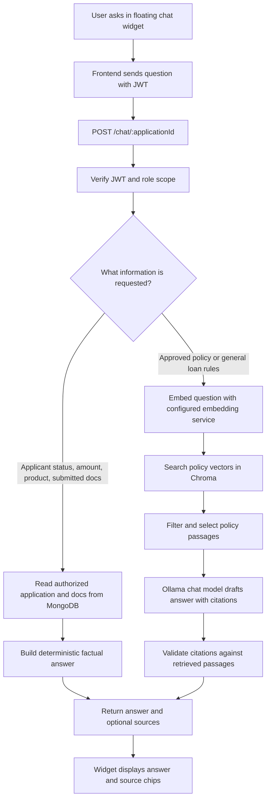

# LoanLens RAG: End-to-End Guide

This guide documents the complete chatbot flow: the UI, backend routing, role checks, MongoDB lookups, policy retrieval, AI models, deployment configuration, and troubleshooting.

## 1. Current RAG setup

The local and Render configurations use different model endpoints. These are the intended settings from the local environment and `render.yaml`; Render dashboard overrides may change the deployed values.

### Local development (`backend/.env`)

| Setting | Current value or purpose |
| --- | --- |
| Chat provider | ollama |
| Mock AI | false |
| Ollama URL | http://localhost:11434 |
| Chat model | qwen2.5:7b |
| Embedding model | nomic-embed-text:latest |
| Chroma URL | https://api.trychroma.com |
| Chroma database | Read from the configured `CHROMA_DATABASE` environment value |
| Chroma collection | loanlens-policies |
| Embedding provider | Ollama (`EMBEDDING_PROVIDER=ollama`) |
| Retrieval limit | 5 final policy chunks |
| Initial distance cutoff | 1.0 L2 distance; not a confidence percentage |

The tenant and Chroma API key are read from `backend/.env`; secrets are intentionally omitted. The repository sample policy set was indexed into this collection as seven files and 47 chunks.

### Render deployment (`render.yaml` defaults)

| Setting | Intended value or purpose |
| --- | --- |
| Chat provider | `ollama` |
| Ollama URL | `https://ollama.com` (cloud endpoint) |
| Chat model | `gemma4:31b` |
| Embedding provider | `chroma-cloud` |
| Chroma embedding URL | `https://embed.trychroma.com/embed` |
| Chroma embedding model | `Qwen/Qwen3-Embedding-0.6B` |
| Chroma collection | `loan-knowledge-qwen` |

Render dashboard environment values can override repository defaults. Check the deployed backend service's Environment page and Logs to confirm the live settings; `render.yaml` alone does not prove what is running.

The Ollama + Chroma path is active only when MOCK_AI=false and CHAT_PROVIDER=ollama. The frontend sends requests to the backend URL configured by EXPO_PUBLIC_API_URL; locally it defaults to http://localhost:4000.

## 2. Roles and screens

### Administrator

The admin role is stored on the MongoDB user record. Public registration accepts borrower or officer only; it cannot create an admin account. Provision an admin from a backend terminal:

~~~powershell
cd D:\LoanLensAI\backend
npm run admin:create
~~~

The command asks for a name and email, then prompts for the password without displaying it. MongoDB stores a bcrypt password hash. The command will not change the role of an account that already uses that email.

At the login page, select **Administrator sign in**. A successful admin login takes the admin directly to the RAG policy document screen. The screen lists indexed files and chunk counts, accepts uploads, and removes documents with their indexed chunks.

The relevant implementation is frontend/src/screens/LoginScreen.js, frontend/src/screens/RagAdminScreen.js, frontend/App.js, backend/src/routes/auth.js, and backend/src/routes/ragAdmin.js.

### Borrower and loan officer

Borrowers and officers use the regular login option. The common floating chat widget is available across the signed-in app while navigating tabs. Borrowers can ask about their own application only. Officers can ask about any application by naming the applicant, provided the name resolves unambiguously in MongoDB. The backend enforces these rules; hiding a control in the frontend is not the security boundary.

Admins see the policy console instead of borrower/officer application screens. The backend checks the admin role too; hiding a screen in the frontend is not the security boundary.

## 3. Where credentials and data are stored

| Information | Storage and handling |
| --- | --- |
| Admin account email and role | MongoDB users collection |
| Admin password | bcrypt hash in the MongoDB passwordHash field; the backend compares a submitted password to this hash |
| Demo admin reference | The demo email and password are constants in LoginScreen.js and are displayed in the admin login card. They are public to anyone who can load the frontend; use only for a demo and replace before public use. |
| Login session | A signed JWT is returned after login. Its signing secret is backend-only JWT_SECRET. The app/browser session is stored in AsyncStorage as loanlens.session. The token expires after 12 hours. |
| Mongo connection credential | backend/.env under MONGODB_URI; this connects to application/account data |
| Chroma Cloud credential | backend/.env under CHROMA_API_KEY; the backend sends it as x-chroma-token. Never put it in frontend code, EXPO_PUBLIC variables, or committed files. |
| Chroma target | Backend settings `CHROMA_BASE_URL`, `CHROMA_TENANT`, `CHROMA_DATABASE`, and `CHROMA_COLLECTION` identify the remote Chroma instance and collection. Local and Render use different collection names. |
| Chat model settings | Backend settings `CHAT_PROVIDER`, `OLLAMA_BASE_URL`, `OLLAMA_CHAT_MODEL`, and optional `OLLAMA_API_KEY`. The chat model generates policy answers; it does not create application facts. |
| Embedding settings | `EMBEDDING_PROVIDER` selects the embedding service. Local defaults to Ollama; Render is configured for Chroma Cloud embeddings. Embeddings represent policy text and questions as vectors; they do not write answers. |
| Borrower uploaded files | Stored through the application document flow, normally MongoDB unless STORAGE_PROVIDER selects R2. These files are separate from the RAG policy collection. |
| Admin-uploaded policy file | File bytes stay in backend memory while processing. Extracted text, chunks, vectors, and source metadata are written to Chroma. The original PDF/text file is not retained by this admin upload flow. |

The Chroma key previously pasted into chat should be rotated and replaced in backend/.env. If deploying, set the new key in the backend service environment as well. Never put it in frontend configuration or this document.

The current demo admin reference shown in the frontend card is email admin@loanlens.demo and password demo@12345678. These values are constants in LoginScreen.js and are visible to anyone who can load the frontend. The admin account in MongoDB stores only a bcrypt hash for the password. This is a demo convenience, not secure production credential handling; replace the account and remove the hard-coded reference values before making the app public.

## 4. Admin document upload: file to vector store

Upload approved policy or FAQ material from the **RAG policy documents** screen. The browser calls the backend, which authenticates the JWT and requires role=admin for every /rag-admin route.

Supported files and limits:

- Markdown (.md), plain text (.txt), and PDF (.pdf)
- Up to 10 files in one batch
- Up to 10 MiB per file
- PDFs must contain selectable text; scanned PDFs need OCR before upload
- Extracted documents need at least 80 characters of usable text

The backend uses memory-backed multipart upload. It sanitizes filenames and checks extensions. Markdown and text files are decoded as UTF-8. For PDFs, PDF.js extracts selectable text page by page, up to 150 pages. It does not run OCR.

The ingestion service then:

1. Normalizes text and splits it around Markdown headings and paragraphs.
2. Builds chunks around 1,200 characters. Very long paragraphs are split with a 120-character overlap so a boundary does not discard all context.
3. Gives each chunk a stable ID and metadata: document ID, filename, title, section, category, chunk index, content hash, and modified time. Borrower/application data is not added.
4. Sends chunk text to the configured embedding provider in batches of up to 32. Locally this is Ollama; Render is configured for Chroma Cloud embeddings.
5. Sends chunk text, metadata, IDs, and vectors to Chroma using its HTTP API.
6. Removes old chunk IDs for the same document when a re-upload results in a different chunk set.

Document identity is derived from the filename. Uploading a replacement with the same filename replaces that policy document in the collection. Use distinct filenames for distinct policies.

Chroma stores the extracted text and metadata as well as the embeddings. Chroma is the searchable policy store; MongoDB is not the vector store for the active Ollama path.

### Upload and management endpoints

| Method | Endpoint | Purpose |
| --- | --- | --- |
| GET | /rag-admin/documents | List policy files grouped by document ID and show chunk counts |
| POST | /rag-admin/documents | Upload multipart form data; each file uses the files field |
| DELETE | /rag-admin/documents/:documentId | Delete a policy document and all its indexed chunks |
| GET | /rag-admin/status | Return collection name and policy chunk count |

These endpoints require a valid JWT for an admin. A 401 means there is no valid session; a 403 means the signed-in account lacks the required role.

The checked-in policy Markdown files can also be indexed from a terminal:

~~~powershell
cd D:\LoanLensAI\backend
npm run ingest:chroma
~~~

This reads Markdown files in data/policies and uses the same chunking, embedding, and Chroma configuration. It does not ingest borrower uploads.

## 5. What happens when someone asks the chatbot a question

The signed-in app's floating chat widget sends the question, current application context when available, and recent user turns to `POST /chat/:applicationId`. The backend requires a valid JWT, then checks borrower ownership or officer role before accessing application records. Officers can identify a target applicant in their question. A missing name match must not silently fall back to a different open application. Borrowers asking about another person receive a privacy response.

The chat service first loads application and document state from MongoDB. Then:

- If MOCK_AI=true, it returns a demonstration status summary; no real RAG retrieval or model answer occurs.
- If CHAT_PROVIDER=ollama, it uses Chroma vector search and Ollama.
- If CHAT_PROVIDER=anthropic or CHAT_PROVIDER=groq, the older assistant path loads policy chunks from MongoDB into the prompt. Those modes do not use Chroma vector search.

The active local configuration is CHAT_PROVIDER=ollama and MOCK_AI=false.

### A. Route the question

Deterministic rules classify the question before a model is called. Officer-provided applicant names are also resolved against MongoDB. The active path distinguishes:

- Status question: asks only about the applicant's current status or missing documents.
- Policy question: asks a general loan/policy question, such as required personal-loan documents or income verification.
- Mixed question: asks for both application status and policy information.
- Applicant-specific structured question (loan amount, product, or submitted documents): read from MongoDB.
- Unsupported or ambiguous question: returns a supported-topics message or a clarification.

The router and backend rules, not the language model, decide which source is needed. Recent user turns may be used for follow-up interpretation; the chat route does not save a transcript.

### B. Status-only questions use MongoDB

For status and other structured application questions, the backend reads the authorized application and its documents from MongoDB. It calculates status and missing document types or formats stored fields such as product and requested amount. It returns a deterministic answer without calling Ollama or querying Chroma.

Applicant-specific facts, such as whether an application is pending, are kept separate from general policy knowledge.

### C. Policy questions are embedded and searched

For a policy or mixed question:

1. The configured embedding provider turns the question into a numeric vector: Ollama locally or Chroma Cloud in the Render defaults. A vector represents meaning numerically, allowing related wording to match even when it does not use identical words. Policy chunks and questions must use compatible embedding models and vector dimensions.
2. The backend queries the collection named by `CHROMA_COLLECTION` with that question vector. Chroma compares it with stored chunk vectors using the collection distance metric and returns up to 15 candidates (three times the configured top-five).
3. The backend rejects candidates whose distance exceeds RAG_MAX_DISTANCE, removes duplicate text, and keeps at most five chunks. A lower distance means closer according to the metric. The cutoff is a tuning value, not a confidence score or guarantee of correctness.
4. The backend builds a prompt containing the question, selected policy text, and temporary labels P1, P2, etc. It asks the configured Ollama chat model for plain text with citations such as [P1]. The chat model generates the answer; it is separate from the embedding model.
5. The configured Ollama chat model writes the answer. The backend accepts citations only if they map to chunks retrieved for that question. If the model omits valid citations, the backend makes one correction attempt. If citation validation still fails, it returns an insufficient-evidence response and logs the validation reason without logging the question or policy text.
6. The API returns the answer and source titles/sections. The floating chat widget displays the answer and source chips.

For mixed questions, the status text comes from MongoDB and the policy explanation comes from Chroma plus Ollama. If policy cannot be grounded, the database status remains authoritative and the unsupported policy claim is omitted.

### D. Example sequences

For **“What documents are required for a personal loan?”**:

- The router selects general policy.
- Ollama embeds the question.
- Chroma finds matching sections in personal-loan-requirements.md and may return other nearby chunks.
- Distance filtering and de-duplication select the best evidence.
- Ollama answers from those passages and cites a matching P-label.
- The backend validates the label and maps it to source title, filename, and section.

For **“What is my application status?”**:

- The backend checks the signed-in user's access to the application.
- MongoDB supplies the application and its current document records.
- A deterministic status answer is returned.
- Chroma and Ollama are not needed.

For an officer asking **“How much did Priya Nair request?”**, the backend confirms the officer role, resolves Priya Nair in MongoDB, reads `requestedAmount` from the matching application, and returns that stored value. Chroma and the language model are not needed for this structured fact. A borrower asking about Priya receives a privacy response; mentioning a name does not grant access.

### E. Complete request flow

Tools used: React Native/Expo for the frontend, Node.js/Express for the API, JWT for identity, MongoDB Atlas with Mongoose for user/application/document data, Chroma Cloud for policy vectors, and Ollama for policy answer generation. Embeddings use local Ollama or Chroma Cloud according to configuration. Routing, access control, structured fact formatting, and citation validation are application code, not AI models.

### F. What each database stores

| MongoDB collection | Chat responsibility |
| --- | --- |
| `users` | Login identity, password hash, and role. |
| `applications` | Applicant name/email, loan product, requested amount, status, and required document types. Applicant email is a soft link in this design, not a database-enforced foreign key. |
| `documents` | Borrower uploads and extracted/verification data, associated with an application using `applicationId`. |
| `policychunks` | Legacy Mongo-backed policy text used by older Anthropic/Groq paths; not the active Ollama + Chroma policy search. |

Chroma stores approved policy text chunks, metadata, and embeddings. Borrower records and borrower uploads should not be placed in this policy collection. Application questions read MongoDB; general policy questions search Chroma.

## 6. Troubleshooting

| Symptom | Checks |
| --- | --- |
| Supported-topics message for a loan question | The wording may not match a router rule. Inspect backend/src/services/loanQuestionRouter.js and confirm the backend restarted after changes. |
| “Could not find relevant information” | Confirm the document is listed in the admin console, has readable text/chunks, and is in the configured Chroma tenant/database/collection. Review RAG_MAX_DISTANCE and try another wording. |
| “Could not verify a relevant policy source” | Retrieval found evidence but the model returned no usable citation. Check backend runtime logs for `[ragOllama] answer validation failed` and `[ragOllama] answer rejected after citation correction`. |
| Ollama connection error | Ensure Ollama is running, both configured models are installed, and OLLAMA_BASE_URL is reachable from the backend host. |
| Chroma connection/authentication error | Check CHROMA_BASE_URL, tenant/database/collection, and the rotated CHROMA_API_KEY in the backend environment. |
| Admin console returns 401 | Sign in again; the JWT expires after 12 hours. |
| Admin console returns 403 | The account must have role=admin in MongoDB. Public registration cannot grant this role. |
| An upload is rejected | Check file extension, 10 MiB limit, readable UTF-8, PDF text layer, and the minimum 80-character requirement. |

## 7. Local versus Render deployment

The local `OLLAMA_BASE_URL` is `http://localhost:11434`, which works when the backend can reach Ollama on the same computer. In a Render container, localhost means that container, not your laptop. The checked-in Render defaults instead use Ollama Cloud for chat and Chroma Cloud for embeddings. Configure `OLLAMA_API_KEY`, `CHROMA_API_KEY`, and the Chroma target settings in the Render backend environment. Confirm effective settings and runtime errors in the Render backend logs. Never commit secrets or include them in this guide.

Chroma Cloud is remote and can be reached from local or Render when the backend has the correct endpoint, tenant, database, collection, and API key. Set the secret in the backend service environment, never in the static frontend. A URL mentioned elsewhere in project docs is not proof that a deployment currently uses Ollama or that its health has been verified.

## 8. Source files for this flow

- frontend/src/screens/LoginScreen.js — separate admin sign-in and demo credential reference
- frontend/src/screens/RagAdminScreen.js — upload, list, refresh, and remove policy documents
- frontend/src/components/FloatingChatWidget.js — common signed-in chat UI
- frontend/src/api/client.js — admin and chat HTTP requests
- frontend/App.js — app navigation and role-specific routes
- backend/src/routes/auth.js — login, admin role restriction, and session token
- backend/src/scripts/createAdmin.js — interactive admin creation
- backend/src/routes/ragAdmin.js — admin-only upload/list/delete/status endpoints
- backend/src/services/policyFileText.js — text/PDF extraction and validation
- backend/src/services/policyChunker.js — policy chunking and stable IDs
- backend/src/services/policyIngestion.js — embedding and Chroma upsert/update
- backend/src/services/ollamaClient.js — Ollama embedding and chat requests
- backend/src/services/chromaService.js — Chroma Cloud HTTP API adapter
- backend/src/services/loanQuestionRouter.js — status/policy/unsupported routing
- backend/src/services/ragOllama.js — question embedding, retrieval, grounded answer, status composition
- backend/src/services/ragPromptBuilder.js — prompt format and citation checks
- backend/src/services/rag.js — selects mock, Anthropic, Groq, or Ollama assistant path
- backend/src/routes/chat.js — JWT check, application authorization, and chat request handling
- backend/src/models/User.js, backend/src/models/Application.js, backend/src/models/Document.js, and backend/src/models/PolicyChunk.js — MongoDB schemas
